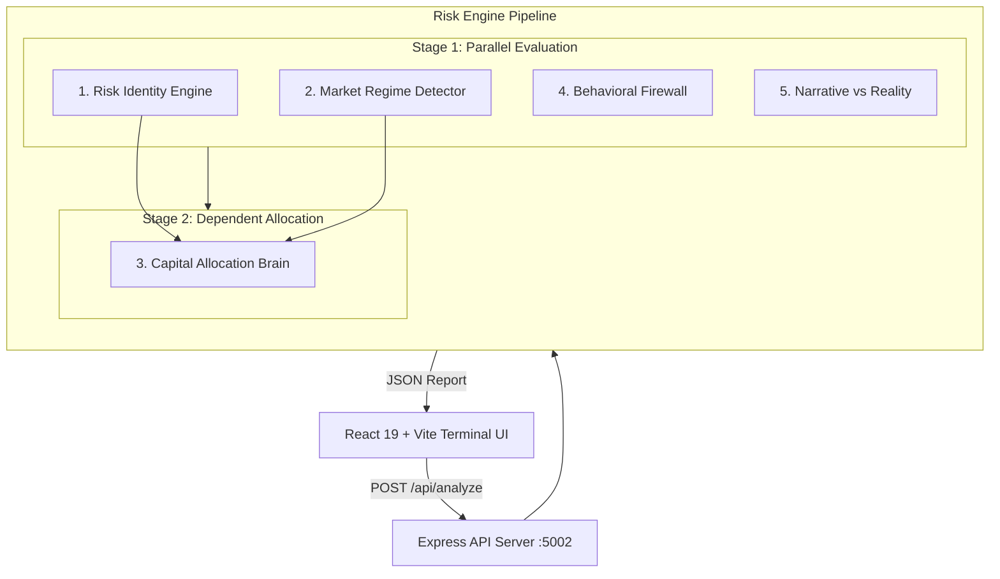

# Antigravity — Investment Intelligence Engine 🧠📈

A hedge-fund-inspired investment decision support system and risk engine. Built with the mindset of senior macro risk strategists (Bridgewater / Goldman Sachs methodology), focusing on **capital preservation first**, **asymmetric upside second**, and **behavioral risk elimination always**.

---

## 🌟 Overview

Traditional financial tools classify investors into static "conservative" or "aggressive" buckets and focus on stock picking. The **Investment Intelligence Engine** takes a probabilistic macro & behavioral approach:

- **Quantifies Risk**: Evaluates maximum tolerable drawdowns, recovery patience, and emotional volatility.
- **Detects Market Regimes**: Analyzes macro liquidity, central bank actions, and volatility regimes.
- **Dynamic Capital Allocation**: Recommends defensive, cash, and equity exposures based on real-time regime + risk alignment.
- **Behavioral Circuit Breaker**: Flags cognitive biases (FOMO, revenge trading, overconfidence) and enforces intervention caps.
- **Narrative vs. Reality**: Analyzes crowded market themes and highlights asymmetric downside risks when pricing perfection is decoupled from fundamentals.

---

## 🏛️ System Architecture



### The 5 Core Intelligence Modules

| Module | Purpose | Key Outputs |
| :--- | :--- | :--- |
| **1. Risk Identity Engine** | Profiles behavioral tolerance & psychological drawdown pain thresholds. | Max drawdown tolerance, patience (months), emotional volatility score, risk statement. |
| **2. Market Regime Detector** | Classifies macro market regime and systemic tail-risk probability. | Regime type (liquidity expansion, contraction, high volatility), 6M crash probability. |
| **3. Capital Allocation Brain** | Synthesizes Risk Identity + Market Regime to determine exposure levels. | Equity %, Cash %, Defensive (Gold/Bonds) %, Scaling guidance (increase / hold / reduce). |
| **4. Behavioral Firewall** | Acts as an automated emotional circuit breaker. | Triggered bias alerts (e.g. FOMO entry), intervention requirements, max position caps. |
| **5. Narrative vs. Reality** | Detects crowded consensus trades and pricing anomalies. | Dominant narrative, narrative strength (0–100), reality gap assessment. |

---

## 💻 Tech Stack

### Frontend (`client/`)
- **Framework**: React 19 + Vite 7
- **Styling**: Tailwind CSS (dark finance terminal design system)
- **Icons & Motion**: Lucide React, Framer Motion
- **Visualization**: Recharts

### Backend (`server/`)
- **Runtime**: Node.js + Express 5
- **Middleware**: CORS, Body Parser, Dotenv
- **AI / LLM Integration**: Modular prompt templates (`utils/prompts.js`) with OpenAI API readiness and built-in mock simulation.

---

## 📁 Project Structure

```text
investment-engine/
├── package.json               # Root convenience scripts
├── .gitignore                 # Git ignore rules (.env, node_modules, etc.)
├── README.md                  # Project documentation
│
├── client/                    # Frontend React Application
│   ├── src/
│   │   ├── components/
│   │   │   ├── CapitalAllocationCard.jsx
│   │   │   ├── MarketRegimeCard.jsx
│   │   │   └── RiskIdentityCard.jsx
│   │   ├── services/
│   │   │   └── api.js         # API client pointing to backend :5002
│   │   ├── App.jsx            # Main dashboard terminal UI
│   │   ├── main.jsx           # React DOM entry point
│   │   └── index.css          # Theme tokens and custom glassmorphism styles
│   ├── tailwind.config.js     # Custom financial color palette
│   ├── vite.config.js
│   └── package.json
│
└── server/                    # Backend API Service
    ├── routes/
    │   └── api.js             # POST /api/analyze router
    ├── services/
    │   ├── aiService.js       # AI orchestration & mock response logic
    │   └── riskEngine.js      # Parallel & sequential module execution pipeline
    ├── utils/
    │   └── prompts.js         # Quantitative hedge-fund prompt definitions
    ├── .env                   # Environment variables (PORT, OPENAI_API_KEY, MOCK_MODE)
    ├── index.js               # Express application entry point (Port 5002)
    └── package.json
```

---

## 🚀 Getting Started

### Prerequisites
- [Node.js](https://nodejs.org/) (v18 or higher recommended)
- `npm` (v9 or higher)

### 1. Installation

Install dependencies for both client and server:

```bash
# Install backend dependencies
cd server
npm install

# Install frontend dependencies
cd ../client
npm install

# Return to root
cd ..
```

### 2. Environment Configuration

Check or create `server/.env`:

```env
PORT=5002
MOCK_MODE=true
OPENAI_API_KEY=your_openai_api_key_here
```

> **Note**: Setting `MOCK_MODE=true` (or leaving `OPENAI_API_KEY` blank) allows testing the full pipeline and UI without incurring API token costs.

### 3. Running the Application

You can start both services from the root folder or run them independently:

#### From the root directory:
```bash
# Run both Backend and Frontend concurrently
npm run dev

# Or run separately:
npm run server    # Backend on http://localhost:5002
npm run client    # Frontend on http://localhost:5173
```

#### Directly from subdirectories:
```bash
# Backend
cd server && node index.js

# Frontend
cd client && npm run dev
```

Open your browser at **[http://localhost:5173](http://localhost:5173)** to interact with the engine.

---

## 🧪 API Reference

### Health Check
```http
GET http://localhost:5002/
```
**Response:**
```json
{
  "status": "ok",
  "msg": "Investment Intelligence Engine Online"
}
```

### Execute Analysis
```http
POST http://localhost:5002/api/analyze
Content-Type: application/json
```

**Request Body:**
```json
{
  "userProfile": {
    "description": "I am a growth investor but I panic when markets drop more than 15%."
  },
  "marketData": {
    "summary": "Volatility is rising, central banks are tightening liquidity."
  },
  "marketContext": "Everyone is saying AI is the future and tech stocks will go up forever."
}
```

**Response Example:**
```json
{
  "risk_identity": {
    "max_tolerable_drawdown": 0.12,
    "recovery_patience_months": 18,
    "income_dependence": "low",
    "emotional_volatility_score": 30,
    "confidence_score": 0.85,
    "risk_statement": "You are a capital preservationist. Downside protection is the primary constraint."
  },
  "market_regime": {
    "regime_type": "high_volatility",
    "crash_probability_6m": 0.35,
    "regime_description": "Liquidity contracting due to central bank tightening. Correlation breakdown observed across asset classes."
  },
  "capital_allocation": {
    "equity_exposure": 0.30,
    "cash_allocation": 0.50,
    "defensive_allocation": 0.10,
    "scaling_guidance": "reduce",
    "reasoning": "Market regime risk is elevated. Reducing equity beta while maintaining some asymmetric upside exposure."
  },
  "behavioral_alerts": [
    "FOMO Entry Detected",
    "Trade Frequency Spike"
  ],
  "narrative_analysis": {
    "dominant_narrative": "AI Supercycle lasts forever",
    "narrative_strength": 95,
    "reality_gap": "high",
    "assessment": "Theme is priced for perfection. Asymmetric downside risk is high."
  },
  "executive_summary": "Risk Identity: You are a capital preservationist... Regime: high_volatility. Allocation: Market regime risk is elevated..."
}
```

---

## 🛡️ License

ISC License. See individual package configurations for details.
